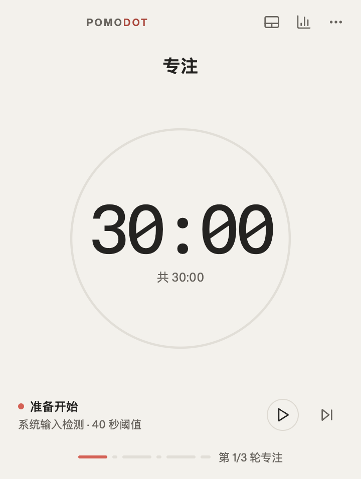
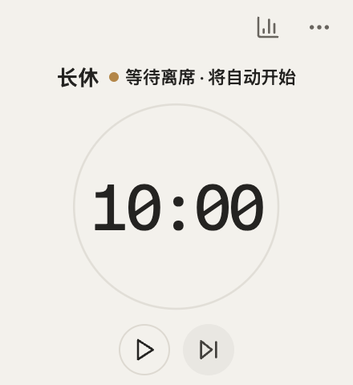

# PomoTimer · Pomodot

面向 macOS 和 Windows 的本地桌面番茄钟。用可配置的专注与休息节奏、系统输入闲置检测和本地统计，记录真正完成的专注轮次。

仓库名为 **PomoTimer**，安装包以 **Pomodot** 发布，应用内名称为 **Pomodoro Timer**。

[下载安装包](https://github.com/Jaxon1216/PomoTimer/releases/tag/v0.1.0-beta.2) · [更新记录](CHANGELOG.md) · [文档索引](docs/README.md) · [问题反馈](https://github.com/Jaxon1216/PomoTimer/issues)

## 下载与安装

安装包是普通用户的使用入口，**不需要安装 Node.js、运行 npm 或自行编译**。macOS 免费分发包可能需要在首次打开时手动允许，具体方法与限制见下文。

下方下载目前仍是 **v0.1.0-beta.2（预发布）旧包**，未包含本次签名修复，也未完成下载与首次打开验收。新的免费分发构建尚未发布，不能用新构建的验证结果保证旧包可用。

| 平台 | 安装包 |
| --- | --- |
| Windows x64 | [EXE 安装向导](https://github.com/Jaxon1216/PomoTimer/releases/download/v0.1.0-beta.2/Pomodot-0.1.0-beta.2-windows-x64-setup.exe) |
| macOS Apple Silicon | [ARM64 DMG](https://github.com/Jaxon1216/PomoTimer/releases/download/v0.1.0-beta.2/Pomodot-0.1.0-beta.2-mac-arm64.dmg) |
| macOS Intel | [x64 DMG](https://github.com/Jaxon1216/PomoTimer/releases/download/v0.1.0-beta.2/Pomodot-0.1.0-beta.2-mac-x64.dmg) |

- macOS：打开与芯片类型匹配的 DMG，将应用拖入 Applications。
- Windows：运行 EXE 安装向导，可选择安装目录。
- 下载后可与同一发布中的 [SHA256SUMS](https://github.com/Jaxon1216/PomoTimer/releases/download/v0.1.0-beta.2/SHA256SUMS) 核对文件校验值。
- 当前公开安装包**未使用开发者证书签名，macOS 也未公证**。系统可能阻止打开或提示未知发布者。

### macOS 首次打开

Intel Mac 选择 **x64**，M 系列芯片选择 **ARM64**；可在苹果菜单的“关于本机”中确认。打开 DMG 后，先将应用拖入 Applications，再从 Applications 启动。

如果提示“无法验证开发者”或“Apple 无法检查是否包含恶意软件”，先确认文件来自本仓库 Release 且校验值一致，再按 [Apple 官方说明](https://support.apple.com/zh-cn/102445)进入“系统设置 → 隐私与安全性 → 仍要打开”，仅为这个应用添加例外。macOS 15 Sequoia 起，[Control-click 打开的旧方法不再适用](https://developer.apple.com/news/?id=saqachfa)。受组织管理的电脑可能不允许添加例外。

如果提示“已损坏”“将损坏你的电脑”，或根本没有“仍要打开”，请记录完整提示、macOS 版本和下载的文件名后反馈；不要直接按未知开发者问题处理，也不要全局关闭系统安全保护。**现有 beta.2 尚未通过完整下载与首次打开验收，不能保证手动允许后就能运行。**

当前源码为下一版 macOS 安装包配置了免费的 **ad hoc 签名**，用于检查代码完整性，并保留 hardened runtime。它不提供 Apple 认可的开发者身份，也不等于公证，因此仍可能需要上述手动批准。此改动**尚未发布到上方 beta.2 下载包**；验收状态见[安装分发验证](docs/roadmap.md#安装分发验证)。

### 版本与已知限制

**主分支不等于已发布安装包。** `main` 已合入[计时器故障恢复、数据保护和实时统计修复（#2）](https://github.com/Jaxon1216/PomoTimer/pull/2)，这些改动尚未包含在上面的 beta.2 安装包中；体验主分支需从源码运行。以下功能和开发说明以当前主分支为准，下载版以[对应发布说明](https://github.com/Jaxon1216/PomoTimer/releases/tag/v0.1.0-beta.2)为准。

beta.2 已知问题：

- 锁屏事件尚未接入，锁屏前请手动暂停。
- 部分旧快照可能无法升级恢复，升级前请备份本地数据。
- 统计页停留期间不会实时刷新，重新进入页面可刷新。
- 输入检测持续故障时，手动继续可能再次被暂停。

安装包已在 GitHub runner 完成构建和打包应用自动化检查；真实设备的系统输入、通知、锁屏、睡眠及人工安装验证仍未全部完成。模拟事件和自动化启动测试不代表真实平台验收，详见 [Phase 1 发布门](docs/roadmap.md#phase-1-发布门)。

## 主要功能

- **可配置节奏**：默认 `30 / 5 / 30 / 5 / 30 / 10` 分钟，三轮专注后进入长休；可调整各轮时长和每周期专注轮数。
- **输入闲置检测**：默认连续 40 秒无系统输入后暂停专注，恢复输入后按状态自动继续；手动暂停不会被自动解除。
- **两种休息模式**：活动休息与桌前休息。当前均基于无输入信号判断开始与暂停，不代表已验证离席、走动或运动。
- **本地统计**：今日、本周和最近 52 周热力图；只有完整完成的专注轮才计入统计，跳过或重置不计入。
- **桌面控制**：拖动窗口边缘缩放计时器，拖动留白移动窗口。支持置顶、托盘菜单、系统通知，以及浅色/深色/跟随系统主题。
- **恢复与数据保护（主分支）**：睡眠与重启不补计离线时间；锁屏门禁、输入故障下的显式手动计时、单实例保护、SQLite 故障备份与用户确认重建。

### 界面预览

| 初始窗口 · 等待开始 | 拖小窗口 · 等待活动休息 |
| --- | --- |
|  |  |

这两张图来自开发版在 macOS 上的真实 Electron 测试窗口。[截图版本与重现方法](docs/README.md#产品截图)

### 基本使用

1. 打开应用，点击开始进入第一轮专注。
2. 专注完整结束后进入休息轮。休息默认等待无输入条件，也可手动开始；再次输入仍可能自动暂停休息。
3. 使用暂停/继续控制当前轮，或点击下一步跳过；下一轮专注需要手动开始。
4. 点击计时器右上角的统计图标查看专注记录，点击“更多操作”打开设置。修改节奏后，正在运行的轮次仍按原计划计时。[设置生效时机](docs/product-spec.md#2-默认配置与设置)
5. 在开发版中，拖动窗口边缘调整大小，拖动计时器上的留白移动窗口。内容区域最小为 160×180，宽 160 px 时最高可拉到 240 px。小窗仍显示轮次、剩余时间和暂停原因，可直接点圆形播放按钮继续，或点统计图标查看记录。[查看最小窗口](docs/assets/screenshots/drag-minimum-interrupted-break.png)

## 本地数据与隐私

应用离线运行，设置、计时快照和完成记录保存在当前设备的 SQLite 数据库中，文件为 Electron `app.getPath("userData")` 下的 `pomodoro.sqlite`。

系统输入检测只读取“距最近一次系统输入的秒数”，不记录按键内容、鼠标位置、活动窗口或屏幕内容。当前没有账号、云同步或遥测，也没有启用摄像头检测；摄像头在场和手动站立专注属于后续阶段，Linux 不在当前支持范围。

开发版只在内存中使用闲置秒数和推断出的在场状态。重启后会恢复轮次和剩余时间，等新的输入采样再判断在场状态。从旧版本升级时，已有备份保留原样；详见[更新记录](CHANGELOG.md)。

## 从源码开发

使用 macOS 或 Windows、Git、**Node.js 24 和 npm**（与当前 CI 一致）。

```sh
git clone https://github.com/Jaxon1216/PomoTimer.git
cd PomoTimer
npm ci
npm run dev
```

项目使用 npm workspaces 和根目录 `package-lock.json`。`dev` 会先为当前 Electron 重建原生依赖，再启动 electron-vite；需要可用的本机图形环境，不能用普通浏览器替代完整桌面验证。

在仓库根目录执行：

| 命令 | 用途 |
| --- | --- |
| `npm run lint` | ESLint 检查，警告视为失败 |
| `npm run typecheck` | Main/preload 与 renderer 的 TypeScript 检查 |
| `npm run test` | Vitest 单元与组件测试 |
| `npm run test:store` | 重建原生依赖，使用 Electron 运行时验证真实 SQLite |
| `npm run test:e2e` | 构建、重建原生依赖并运行 Playwright Electron E2E |
| `npm run build` | 构建应用代码 |
| `npm run package` | 先构建，再使用 electron-builder 生成当前平台安装包 |
| `npm run test:packaging` | 仅 macOS；打包后对真实 `.app` 验签，并验证篡改资源与原生模块会被拒绝 |

安装包输出在 `apps/desktop/dist/`。打包后，可在对应系统运行 `node scripts/smoke-packaged.mjs` 检查打包应用。macOS 另提供签名和 DMG 检查，见[安装包与预发布](docs/README.md#安装包与预发布)；开发启动与原生回归说明见[开发验证文档](docs/README.md#本地原生回归)。

CI 在 macOS 和 Windows 上运行 lint、类型检查、单元测试、原生数据库测试和 Electron E2E。两个 macOS runner 分别构建 ARM64 与 x64 DMG，再运行真实应用的签名回归与 DMG 检查；Windows 不运行这些 macOS 签名测试。发布工作流另包含 Windows x64 安装包构建与启动检查。自动化不代替经浏览器下载、Finder 首次打开及系统批准的人工验收。

## 架构与目录

```text
React renderer
    ↓ 类型化 window.pomodoro API
受限 preload
    ↓ 白名单 IPC + Zod 校验
Electron main
    ├─ TimerEngine：唯一计时状态，使用单调时钟
    ├─ SqliteStore：唯一数据库访问层
    └─ 窗口、托盘、通知与 powerMonitor
```

React 负责展示和交互，不拥有权威计时或数据库；计时核心是独立于 Electron API 的 TypeScript 模块。当前不使用 Go/Rust 侧车或 HTTP/WebSocket 服务。

```text
apps/desktop/src/main/      Electron 集成、计时核心、统计和 SQLite
apps/desktop/src/preload/   受限的类型化桌面 API
apps/desktop/src/renderer/  React 界面与样式
apps/desktop/src/shared/    IPC 类型与运行时 schema
apps/desktop/resources/     打包进应用的图标与托盘资源
tests/e2e/                 Electron 跨进程测试
scripts/                   原生验证、打包检查和发布辅助脚本
.github/                    PR 模板、检查与发布工作流
docs/                      产品、架构、契约与路线图
docs/assets/screenshots/   供阅读文档使用的产品截图
```

## 文档与反馈

- 新接手开发时，先读[协作约定](AGENTS.md)，从[更新记录](CHANGELOG.md)了解已发布与待发布的改动，再按[文档索引](docs/README.md)找到本次改动涉及的规格、代码入口和验收要求。
- [产品规格](docs/product-spec.md)：默认值、计时规则和交互边界。
- [技术架构](docs/architecture.md)：进程职责、平台集成和数据保护。
- [IPC 与持久化契约](docs/contracts.md)：类型、事件和数据库模型。
- [分阶段路线图](docs/roadmap.md)：当前范围、未来能力和发布门。
- [第三方资源说明](docs/third-party-notices.md)：字体和视觉参考来源。

欢迎通过 [Issues](https://github.com/Jaxon1216/PomoTimer/issues) 反馈问题。请附上操作系统、芯片架构、安装包版本或源码 commit、复现步骤，以及预期与实际结果；分享截图或日志前请先移除个人信息和本地路径。
